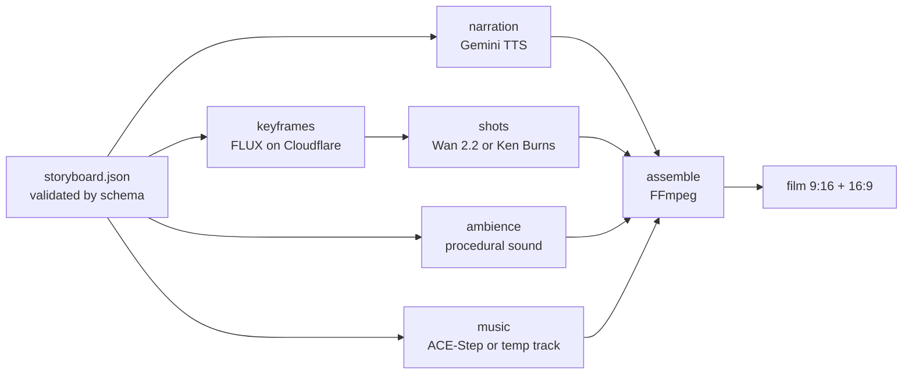

# The Lamp (ብርሃን)

**A 75-second AI short film about Ethiopia, built as a code pipeline.**
What did Ethiopia build when it honoured those who learned, and what happens to a nation when it stops?

A brass lamp and an open book pass through every era: Lalibela, Adwa, the modern university, 1974, and today.
Narration in **Amharic**, English subtitles, original sound design, an AI end card. Exported in **9:16** and **16:9**.

| | |
|---|---|
| **Film (9:16)** |outputs\final\film_9x16.mp4 |
| **Film (16:9)** | outputs\final\film_16x9.mp4 |
| **Walkthrough (max 5 min)** | https://drive.google.com/file/d/1gDOFzEFd6Rh9yS04R0dd92ExEvJHv0FL/view?usp=sharing|

> **The idea:** one file, `storyboard.json`, is the contract. Every stage reads it and writes its own output, so you can change one shot and regenerate only that shot.

---

## How it works



| Stage | Script | Model / tool | Runs on | Output |
|---|---|---|---|---|
| Contract | `pipeline/validate.py` | JSON Schema | local | fails fast on a bad storyboard |
| Narration | `pipeline/narration.py` | Gemini 3.8 Flash TTS (Amharic) | Gemini API | `outputs/narration/sNN.wav` |
| Keyframes | `pipeline/keyframes.py` | FLUX.1 schnell | Cloudflare Workers AI | `outputs/keyframes/sNN.png` |
| Moving shots | `pipeline/shots.py` | Wan 2.2 clip if present, else Ken Burns | local FFmpeg / Kaggle GPU | `outputs/shots/sNN_{v,h}.mp4` |
| Sound design | `pipeline/ambience.py` | original, synthesised in code | local | church bell, kebero, choir drone and more |
| Score | `pipeline/music.py` | ACE-Step 1.5 pick, else procedural temp track | Kaggle / local | `outputs/music/score.wav` |
| Assembly | `pipeline/assemble.py` | FFmpeg + numpy | local | both MP4s and subtitles |

**Engineering choices**
- **Narration sets the timing.** Each shot lasts as long as its voice line needs, so picture, subtitles, sound and music all follow the voice.
- **Caching.** Every output has a hash of its inputs. Re-running skips what did not change.
- **Retries and rate limits.** Three attempts per call, and a 50-second wait when a free tier returns 429.
- **One log line per call** in `runs.jsonl` (model, voice or seed, input hash, latency, cost, attempt, status).
- **Fallback ladder.** No Wan clip: Ken Burns on the keyframe. No ACE-Step track: procedural score. The film never has a hole.
- **Mix.** Voice, score and ambience are level-matched, the score is ducked under the voice (`sidechaincompress`), then a two-pass `loudnorm` sets -14 LUFS, true peak -1 dB.
- **Secrets** live in `.env` (git-ignored). Stages refuse to run without their keys, and placeholders only run in explicit demo mode.

---

## The church sound

`pipeline/ambience.py` synthesises the sound of each place from code, so it has no licence and uses no quota:
**church bell**, **kebero** drum, **tsenatsel** (sistrum), a distant **choir-like drone**, dawn birds, wind, a quill on parchment,
crowd, an aeroplane, lamp flame, room tone, a suitcase latch and footsteps.
Each shot lists its layers in `storyboard.json`. The arc is audible: rich in Act 1, drained to room tone and wind in Act 2, returning in Act 3.
Colour grading follows the same arc (`grade.saturation` per shot).

---

## Run it

### Windows (PowerShell)
```powershell
git clone https://github.com/melat33/ai-content-generation-the-lamp-birhan.git
cd ai-content-generation-the-lamp-birhan

python -m venv .venv
.\.venv\Scripts\Activate.ps1
python -m pip install -r requirements.txt

copy .env.example .env
notepad .env                     # add your three keys, save

python pipeline/smoke_test.py    # calls each provider once, logs latency
python pipeline/validate.py
python pipeline/narration.py
python pipeline/keyframes.py
python pipeline/shots.py
python pipeline/ambience.py
python pipeline/music.py
python pipeline/assemble.py
```

### macOS / Linux
```bash
git clone https://github.com/melat33/ai-content-generation-the-lamp-birhan.git
cd ai-content-generation-the-lamp-birhan
python3 -m venv .venv && source .venv/bin/activate
make setup
cp .env.example .env             # add your three keys
make film                        # validate, narration, keyframes, shots, ambience, music, assemble
```

**Needs:** Python 3.10+, FFmpeg 5+ on your PATH, and free accounts for:
Gemini API key ([AI Studio](https://aistudio.google.com/apikey)), Cloudflare Workers AI account ID and token ([dashboard](https://dash.cloudflare.com)).

**Result:** `outputs/final/film_9x16.mp4`, `outputs/final/film_16x9.mp4`, `outputs/final/subs.srt`.

**No keys?** Set `DEMO=1` (PowerShell: `$env:DEMO="1"`) or run `make demo`. It uses painted placeholders and a hum instead of a voice, to prove the pipeline and the edit. It is **not** the film.

Other helpers: `pipeline/radio_cut.py` (narration over black, for user test 1), `pipeline/cost_report.py` (table for `COSTS.md`), `python -m pytest -q tests`.

---

## Regenerate just one shot

Edit one image prompt or one narration line in `storyboard.json`, then run the stage again:
```powershell
python pipeline/keyframes.py --shot s05      # one keyframe
python pipeline/narration.py                 # cached lines print "cached"; only the edited line calls the model
python pipeline/shots.py
python pipeline/assemble.py
```
Add `--force` to ignore the cache for a shot.

---

## The storyboard contract

Every shot carries its own reason, prompts and sound plan:

```json
{
  "id": "s05", "act": "fall", "duration_s": 7, "shot_size": "close",
  "reason": "Turning point: the light begins to fail",
  "image_prompt": "Close-up of the brass lamp, flame small and trembling...",
  "motion_prompt": "Slow push-in, flame flickers weakly, colour drains slowly",
  "narration": { "am": "የተማሩትን እናከብር ስለነበር ገነባን።", "en": "Because we honoured those who learned, we built." },
  "grade": { "saturation": 0.7 },
  "ambience": [ { "type": "flame", "gain_db": -8 }, { "type": "room_tone", "gain_db": -20 } ],
  "seed": 3005
}
```
The schema is in `schema/storyboard.schema.json` and is checked before every run.

---

## Moving shots on a GPU (optional)

Wan 2.2 and ACE-Step need a GPU, so they run in notebooks:
1. Upload `storyboard.json` and `outputs/keyframes/` to Kaggle, then run `notebooks/kaggle_wan.py`.
2. Copy the clips into `outputs/wan/`, then run `shots.py` and `assemble.py` again.
3. For the score, follow `notebooks/acestep_notes.md`, then `python pipeline/music.py --choose FILE --why "reason"`.

---

## Status

Update this table as you finish things. Only tick what is really done.

| Item | Status |
|---|---|
| Storyboard contract, schema, tests | done |
| Amharic narration (Gemini TTS) | done, 10 lines |
| Keyframes (FLUX.1 schnell on Cloudflare) | done |
| Moving shots | Ken Burns on keyframes; Wan 2.2: _not done / done_ |
| Sound design (church bell, kebero, ambience) | done |
| Score | procedural temp track; ACE-Step: _not done / done_ |
| Assembly, ducking, subtitles, loudness, end card, both ratios | done |
| User test 1 (radio cut, 3+ people) | _fill in `DESIGN.md`_ |
| User test 2 (near-final cut, 3+ people) | _fill in `DESIGN.md`_ |
| Experiments (about 10) | _fill in `EXPERIMENTS.md`_ |

---

## Documentation

| File | What it holds |
|---|---|
| [`ARCHITECTURE.md`](ARCHITECTURE.md) | stages, contracts, caching, failure handling |
| [`DESIGN.md`](DESIGN.md) | audience, intent, the two user tests and what changed |
| [`EXPERIMENTS.md`](EXPERIMENTS.md) | hypothesis, change, result |
| [`FAILURES.md`](FAILURES.md) | what broke and how it was fixed |
| [`COSTS.md`](COSTS.md) | measured latency, free limits, list-price equivalent |
| [`ETHICS.md`](ETHICS.md) | consent, licences, labelling |
| [`WALKTHROUGH.md`](WALKTHROUGH.md) | plan for the 5-minute video |

---

## Ethics and AI disclosure

- No real person's face or voice is generated or cloned. Historical figures appear only as symbols (a crowd, a raised hand, a silhouette).
- The narration uses a stock Gemini voice, not a clone.
- The film ends with an end card: **Made with AI by Melat Tewachew**. It is posted with the platform's AI label switched on.
- The decline is posed as a question, not a verdict, and names no group as the culprit.

Licences of every model and output are listed in `ETHICS.md`.

## License

MIT, see [`LICENSE`](LICENSE). Generated media follows the licences of the models that produced it.